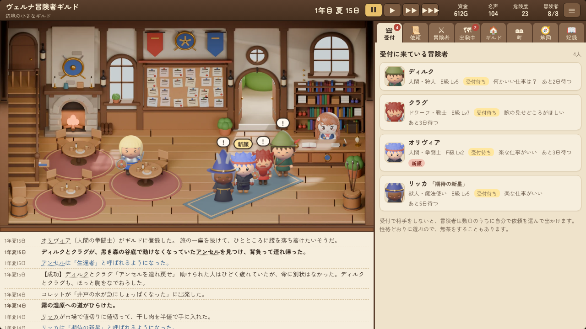

# 冒険者ギルドの受付嬢（体験版）

冒険者ギルドの受付になって、やって来る冒険者に依頼をすすめる、見守り型のシミュレーションゲームです。パソコンやスマホのブラウザで、インストールなしで遊べます。

- 遊ぶ：https://paz67416.github.io/guild-uketsuke/
- 体験版で遊べるのは、1年目の冬の終わりまでです（20〜30分ほど）
- 製品版（5年目の冬までの物語と、竜の襲来の4つの結末）は、note の記事で販売しています：https://note.com/chodo_lab/n/nf8b9cd07eff6

1枚のHTMLで動きます。遊んだ内容はどこにも送信しません（記録は、遊んだブラウザの中にだけ残ります）。

プログラム・文章・音楽は AI（Anthropic の Claude）が作り、絵は AI が 3D ソフトの Blender を動かして作りました。画像生成AIは使っていません。

作った人：余白の実験室（https://note.com/chodo_lab）

書体：Zen Maru Gothic（SIL Open Font License 1.1。`license/ZenMaruGothic_OFL.txt`）
